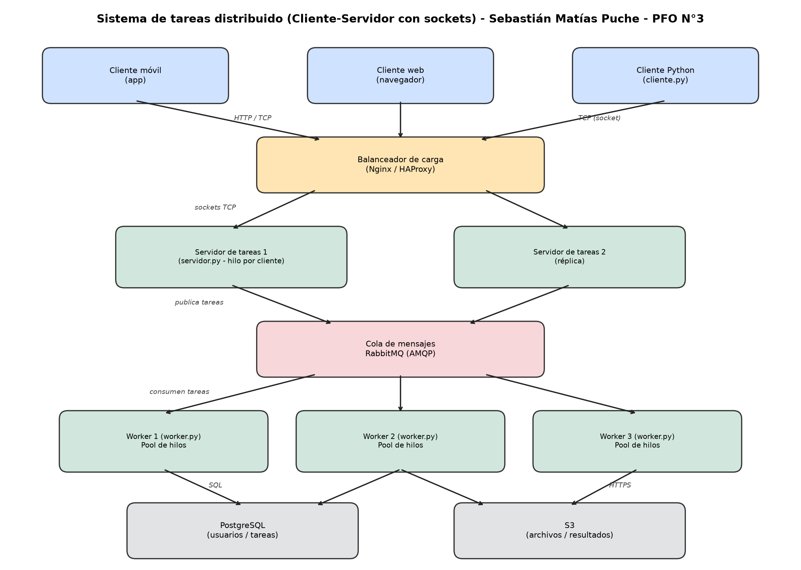

# PFO 3 – Rediseño como Sistema Distribuido (Cliente-Servidor)

Evolución del sistema de tareas del PFO 2 (Flask + SQLite) hacia una arquitectura distribuida
basada en **sockets TCP**: un servidor recibe tareas de los clientes y las reparte entre varios
**workers**, cada uno con su propio **pool de hilos**.



## Arquitectura

| Componente | Rol | ¿Implementado en este repo? |
|---|---|---|
| Clientes (móvil, web, Python) | Envían tareas y reciben resultados | `cliente.py` (cliente Python) |
| Balanceador de carga (Nginx / HAProxy) | Reparte conexiones entre réplicas del servidor | Diseño (ver abajo) |
| Servidor de tareas | Recibe tareas por socket y las distribuye | `servidor.py` |
| Workers | Procesan tareas con un pool de hilos | `worker.py` |
| Cola de mensajes (RabbitMQ) | Desacopla servidores y workers | Diseño (ver abajo) |
| Almacenamiento (PostgreSQL, S3) | Datos estructurados y archivos | Diseño (ver abajo) |

### Cómo se integrarían los componentes no implementados

- **Nginx / HAProxy**: en modo TCP (`stream` en Nginx), delante de varias réplicas de `servidor.py`,
  con health checks y algoritmo round-robin o least-connections.
- **RabbitMQ**: en lugar de que el servidor se conecte directo al worker, publicaría la tarea en una
  cola (por ejemplo con `pika`) y los workers la consumirían. Ganamos persistencia de mensajes,
  reintentos y desacople ante la caída de un worker.
- **PostgreSQL**: reemplaza a SQLite del PFO 2 para usuarios y tareas, con acceso concurrente real.
- **S3**: almacenamiento de archivos grandes o resultados; la base guarda solo la referencia (clave del objeto).

## Estructura

```
├── servidor.py          # recibe tareas por socket y las distribuye (round-robin + failover)
├── worker.py            # procesa tareas con ThreadPoolExecutor
├── cliente.py           # envía tareas, recibe resultados, reintenta ante fallos
├── utils.py             # protocolo común (JSON + '\n')
├── generar_diagrama.py  # genera diagrama.png
├── diagrama.png
└── requirements.txt
```

## Protocolo

JSON terminado en salto de línea, sobre TCP.

```
Cliente  -> Servidor : {"tarea": "sumar", "datos": [1, 2, 3]}\n
Servidor -> Cliente  : {"estado": "ok", "resultado": 6, "worker": 6001}\n
Error                : {"estado": "error", "error": "Tarea desconocida: x", "worker": 6001}\n
```

Tareas disponibles: `sumar`, `invertir`, `contar_palabras`, `dormir` (tarea lenta para probar concurrencia).

## Ejecución

- Ejecucion por defecto

```bash
python worker.py 6001
python worker.py 6002
python servidor.py
python cliente.py
```

- Ejecucion personalizada

```bash
python worker.py 6001 4      # worker en el puerto 6001 con pool de 4 hilos
python worker.py 6002 4      # worker en el puerto 6002
python servidor.py 5000 127.0.0.1:6001 127.0.0.1:6002 # puerto y workers explícitos
python cliente.py            # menú interactivo
python cliente.py --demo     # envía tareas de ejemplo
```

## Decisiones de diseño

- **Hilo por cliente en el servidor** (`threading.Thread`), como en el servidor multicliente visto en clase.
- **Round-robin con `Lock`**: el contador de turnos es compartido entre hilos, por eso se protege.
- **Failover**: si un worker no responde, el servidor prueba con el siguiente antes de devolver error.
- **Pool de hilos en el worker** (`ThreadPoolExecutor`): cada conexión se atiende en un hilo del pool,
  limitando la concurrencia por worker.
- **Reintentos en el cliente**: ante errores de conexión reintenta con espera, como en el ejemplo de
  manejo de errores en sockets.
- **Buffer por mensaje**: se lee hasta `\n`, así un mensaje partido en varios paquetes TCP no se rompe.

## Pruebas realizadas

- Reparto de tareas alternado entre los workers 6001 y 6002.
- Dos clientes simultáneos con tareas lentas atendidos en paralelo por distintos workers.
- Caída del worker 6001: el servidor redirige todas las tareas al worker 6002 sin que el cliente falle.
- Tarea inexistente: el cliente recibe un error controlado.

## Limitaciones

Es un prototipo: la comunicación no está cifrada ni autenticada, y el servidor y los workers usan
`localhost`. En producción se agregarían TLS, autenticación (reutilizando el login del PFO 2),
y la infraestructura descrita arriba.
